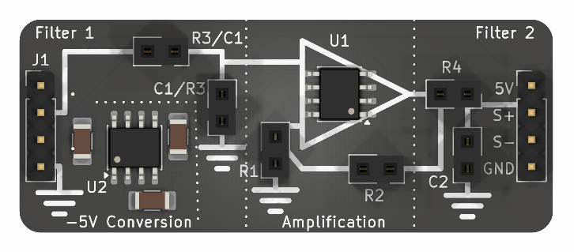

# Filtering Concepts PCB

This repository contains resources for a PCB project designed to help students understand basic filtering concepts in electronics.

https://github.com/user-attachments/assets/0b66fcd6-6c55-42dc-a5e1-664c0480170c

